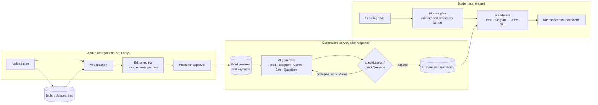

# American Renewal Corps — personalized lesson app

A web app that turns a training plan into lessons in four formats (Read, Diagram, Game, Sim) and delivers them to students weighted toward their chosen learning style. Built for the ARC engineering assignment around the sample module “Cooling & airflow”.

## Technologies

| Area | Technology |
|---|---|
| Framework | Next.js 16 (App Router, server components, server actions), React 19, TypeScript 5.9 |
| Styling | Plain CSS with design tokens (`src/app/system.css`); locally hosted Barlow Condensed and DM Sans |
| Hosting | Vercel (Fluid compute functions, `after()` background work), Vercel Analytics |
| Database | Neon Postgres (via Vercel Marketplace), Drizzle ORM and drizzle-kit migrations, `pg` driver with Vercel’s connection pooling |
| Authentication | Better Auth 1.7: email and password, anonymous demo users, admin plugin with custom roles, optional Google OAuth |
| File storage | Vercel Blob (private store) for uploaded learning plans |
| AI | Vercel AI SDK 7 through Vercel AI Gateway, model Claude Haiku 5.5, structured output validated with Zod |
| Documents | `unpdf` for reading text from uploaded PDFs |
| Email | Resend HTTP API for password reset and email confirmation (switched on by configuration) |
| Illustration | Anatomy isometric SVG kit (MIT) for the interactive data-hall scene; all drawings are SVG generated from data, no AI image generation |
| Validation and tests | Zod schemas for every lesson format; Vitest for content checks |

## Architecture

One Next.js application on Vercel serves the landing page, the student app and the admin area. Server components read from Postgres; server actions handle every write and re-check the user’s role; long AI jobs run after the response with `after()`.



### Content pipeline
1. **Upload.** Staff upload a PDF, Markdown, text or JSON plan. The browser sends the file straight to private Blob storage using a short-lived token issued only to editors and above.
2. **Extract.** The server reads the text and asks the model for an `ExtractedPlan` (module, lab task, skills, topics, objectives, key facts f1…fn, common mistakes). Every fact carries the exact source sentence it came from; a deterministic check flags quotes that are not in the file.
3. **Review and approve.** Editors correct the draft; a publisher approves it. Approval stores the module, its topics and a **new brief version** per topic, so earlier versions are never overwritten.
4. **Generate.** For each topic the generator makes five structured calls in parallel: Read, Diagram, Game, Sim and one question per fact. Each answer is converted into the strict lesson shape from Appendix C and checked:
   - only facts from the brief, and every fact taught;
   - Read lessons of 150–250 words;
   - diagrams inside the canvas with no colliding labels, no overlapping parts, and arrows that connect;
   - games that can be solved and sims and questions with exactly one correct answer.

   Failed checks are sent back to the model, up to three attempts. Every call is logged with its token counts.
5. **Publish.** Lessons that pass are stored and appear for students. An import that is only partly generated can retry just the missing pieces.

### Student side
- **Onboarding** stores a learning style (Read, Diagram, Game or Sim) per user. Visitors get an anonymous account, so the demo works without registering; registering keeps their choices.
- **Module plan** (`buildPlan`) makes the chosen style every topic’s primary format and rotates the other formats as secondaries, so every format is seen across the module. Students can switch style at any time.
- **Renderers** draw each format from data: fact-tagged paragraphs with a quick check, SVG diagrams with caption highlighting, sort/order/match games, and step-by-step sims.
- **Data-hall scene** is a hand-built isometric SVG of a contained cold aisle. Lesson data binds game items and sim decisions to scene states (open door, reversed rack, missing blanking panel, misplaced tile). Students can click parts to change them; illustrative inlet readings respond, and the facts each problem goes against are highlighted in the lesson.
- **Catalog** serves approved, generated modules from the database alongside the hand-written sample module.

### Accounts and roles
- Better Auth stores users and sessions in Postgres; sessions are httpOnly cookies, sign-in is rate-limited.
- Roles: student (default), editor, publisher, admin, defined once with Better Auth’s access control and used by `can(role, action)`.
- The admin area is protected in three layers: a cookie check in `src/proxy.ts`, a role check in the admin layout and every admin page, and a role check in every admin server action. The learner interface has no link to it.
- Admins create staff accounts with a temporary password that must be replaced at first log-in, and can reset other users’ passwords. Password-reset emails, email confirmation and Google sign-in switch on through configuration.

### Data model
| Table | Holds |
|---|---|
| `user`, `session`, `account`, `verification` | Better Auth: accounts, sessions, sign-in methods, verification tokens; `user.role`, `user.is_anonymous`, `user.must_change_password` |
| `learner_profile` | Each user’s learning style |
| `import_job` | Uploaded plan, status (extracting → needs review → generating → published), extracted draft and issues |
| `module`, `topic` | Curriculum structure |
| `brief`, `brief_fact` | Versioned content briefs and their key facts with source quotes |
| `lesson`, `question` | Generated lessons (Appendix C shapes, one per brief version and format) and questions (one per fact) |
| `generation_run` | Every AI call: kind, attempt, result, problems and tokens |

### Project layout
```
src/
  app/                 routes: landing, /start, /register, /login, /account, /learn, /scene, /admin, API routes, server actions
  components/          page shell, forms, lesson renderers, admin UI
    figures/hall/      the data-hall scene (model, layout, server-built art, client interaction)
    iso/               Anatomy isometric drawing kit
  content/             hand-written sample lessons
  db/                  Drizzle schema and client
  lib/
    content/           lesson schemas and checks, extraction, generation, catalog
    auth.ts, permissions.ts, session.ts, email.ts
  landing/             the original framework-free landing experience
drizzle/               SQL migrations
```
