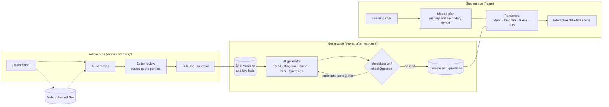
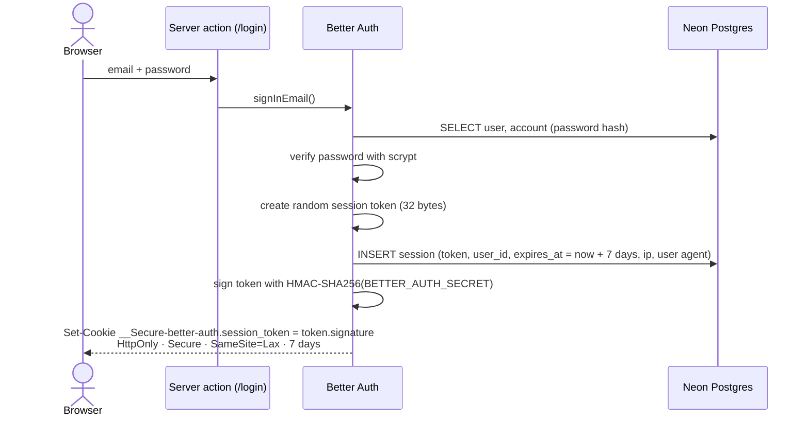
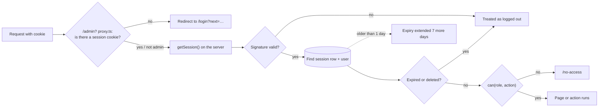

# American Renewal Corps — personalized lesson app

A web app that turns a training plan into lessons in four formats (Read, Diagram, Game, Sim) and delivers them to students weighted toward their chosen learning style. Built for the ARC engineering assignment around the sample module “Cooling & airflow”.

## Technologies

| Area | Technology |
|---|---|
| Framework | Next.js 16 (App Router, server components, server actions), React 19, TypeScript 5.9 |
| Styling | Plain CSS with design tokens (`src/app/system.css`); locally hosted Barlow Condensed headings, Inter copy (via `next/font`) |
| Hosting | Vercel (Fluid compute functions, `after()` background work), Vercel Analytics |
| Database | Neon Postgres (via Vercel Marketplace), Drizzle ORM and drizzle-kit migrations, `pg` driver with Vercel’s connection pooling |
| Authentication | Better Auth 1.7: email and password, anonymous demo users, admin plugin with custom roles, optional Google OAuth |
| File storage | Vercel Blob (private store) for uploaded learning plans |
| AI | Vercel AI SDK 7 through Vercel AI Gateway, model Claude Haiku 5.5, structured output validated with Zod |
| Documents | `unpdf` for reading text from uploaded PDFs |
| Email | Resend HTTP API for password reset and email confirmation (switched on by configuration) |
| Illustration | Anatomy isometric SVG kit (MIT) for the interactive data-hall scene; all drawings are SVG generated from data, no AI image generation |
| Validation and tests | Zod schemas for every lesson format; Vitest for content checks |

## Why these technologies

### Framework: Next.js 16, React 19, TypeScript

| Option | What it would have meant |
|---|---|
| **Next.js (chosen)** | One codebase for the student app, the admin area and the backend. Server components read the database directly, server actions handle forms, and `after()` runs AI generation in the background. |
| React Router 7 / Remix | A similar model, but less built-in support on Vercel, and no `after()` or server components for background work. |
| SvelteKit | A strong framework, but a smaller set of libraries. The Anatomy drawing kit and Better Auth's React helpers are written for React. |
| Vite single-page app + separate API (Express/FastAPI) | Two deployments and two codebases. The same lesson types would be defined twice, and the frontend and backend would drift apart. |

**TypeScript** keeps the whole pipeline on one set of types. A Zod schema describes a lesson once. That one schema checks the AI's output, gets stored in Postgres, and is read by the React renderer, so a field renamed in one place fails the build everywhere it's used.

### Hosting: Vercel vs Cloudflare

| | Vercel (chosen) | Cloudflare Workers |
|---|---|---|
| Next.js support | Built by the same team; every feature works without an adapter | Runs through the OpenNext adapter, and some features lag behind |
| Long AI jobs | Fluid compute functions run up to 300 s by default; generating one module takes about 45 s and runs in `after()` | Workers are limited by CPU time; long jobs need Queues or Durable Objects |
| Previews | A preview URL for every branch, which the assignment asks for | Also has previews, but they need more setup |
| Services | Neon, Blob and AI Gateway install from the Marketplace with environment variables filled in automatically | Would mean D1 or Hyperdrive, R2 and a separate AI provider |
| Cost at scale | Higher per request | Cheaper at very high traffic |

Cloudflare wins on raw cost at very high traffic. For a pitch-sized app with long AI jobs and a preview requirement, Vercel needs the least custom setup.

### Database: Neon Postgres

- Neon is a native Vercel Marketplace integration. One click provisions it, and its connection settings appear in every environment (production, previews and local).
- It's standard Postgres used through Drizzle, so moving to **Supabase** (or any Postgres) means a `pg_dump` and a new `DATABASE_URL`. The schema and queries don't change.
- We didn't choose **Convex** because it isn't a relational database. Our data is relational:
  - modules → topics → versioned briefs → facts → lessons and questions;
  - foreign keys and cascading deletes;
  - a unique constraint on `(topic, version)` so a brief is never overwritten.

  Convex is a document store with its own query language, so we'd have to enforce those rules in application code ourselves.

## Architecture

One Next.js application on Vercel serves the landing page, the student app and the admin area. Server components read from Postgres; server actions handle every write and re-check the user’s role; long AI jobs run after the response with `after()`.



### Content pipeline
1. **Upload.** Staff upload a PDF, Markdown, text or JSON plan. The browser sends the file straight to private Blob storage using a short-lived token issued only to editors and above.
2. **Extract.** The server reads the text and asks the model for an `ExtractedPlan` (module, lab task, skills, topics, objectives, key facts f1…fn, common mistakes). Every fact carries the exact source sentence it came from; a deterministic check flags quotes that are not in the file.
3. **Review and approve.** Editors correct the draft; a publisher approves it. Approval stores the module, its topics and a **new brief version** per topic, so earlier versions are never overwritten.
4. **Generate.** For each topic the generator makes five structured calls in parallel: Read, Diagram, Game, Sim and one question per fact. Each answer is converted into the strict lesson shape from Appendix C and checked:
   - only facts from the brief, and every fact taught;
   - Read lessons of 150–250 words;
   - diagrams inside the canvas with no colliding labels, no overlapping parts, and arrows that connect;
   - games that can be solved and sims and questions with exactly one correct answer.

   Failed checks are sent back to the model, up to three attempts. Every call is logged with its token counts.
5. **Publish.** Lessons that pass are stored and appear for students. An import that is only partly generated can retry just the missing pieces.

### Student side
- **Onboarding** stores a learning style (Read, Diagram, Game or Sim) per user. Visitors get an anonymous account, so the demo works without registering; registering keeps their choices.
- **Module plan** (`buildPlan`) makes the chosen style every topic’s primary format and rotates the other formats as secondaries, so every format is seen across the module. Students can switch style at any time.
- **Renderers** draw each format from data: fact-tagged paragraphs with a quick check, SVG diagrams with caption highlighting, sort/order/match games, and step-by-step sims.
- **Data-hall scene** is a hand-built isometric SVG of a contained cold aisle. Lesson data binds game items and sim decisions to scene states (open door, reversed rack, missing blanking panel, misplaced tile). Students can click parts to change them; illustrative inlet readings respond, and the facts each problem goes against are highlighted in the lesson.
- **Catalog** serves approved, generated modules from the database alongside the hand-written sample module.

### How diagrams are drawn
Diagrams are data, not images: no AI image generation is used. The generator writes shapes with coordinates, and the app draws them as SVG.

**The data.** A diagram lesson is one row in the `lesson` table; its `content` holds a 640 × 360 canvas, a list of elements and a list of captions. Every element and caption names the facts it teaches. Shortened from a real generated lesson:

```json
{
  "title": "Containment: keeping hot and cold air apart",
  "width": 640, "height": 360,
  "elements": [
    { "id": "cold-aisle", "type": "zone",  "x": 160, "y": 40,  "w": 320, "h": 290, "tone": "cool",    "label": "Cold aisle", "facts": ["f1"] },
    { "id": "door-open",  "type": "rect",  "x": 476, "y": 60,  "w": 10,  "h": 200, "tone": "warning", "label": "Door open", "labelAt": "right", "facts": ["f2"] },
    { "id": "hot-leak",   "type": "arrow", "x": 140, "y": 190, "x2": 476, "y2": 190, "tone": "hot", "label": "Hot exhaust leak", "facts": ["f2"] }
  ],
  "captions": [
    { "text": "An open containment door lets hot exhaust leak into the cold aisle.", "facts": ["f2"], "elements": ["door-open", "hot-leak"] }
  ]
}
```

**From the database to the browser.**
```
Postgres (lesson.content, jsonb)
  → catalog.getLesson(topic, "diagram")    server only
  → Lesson.safeParse(...)                  Zod: malformed data never reaches the page
  → LessonPage (server component)
  → DiagramLesson (client component)       receives the JSON as props and draws SVG
```
The browser never queries the database; it receives the JSON as component props.

**Drawing.** `src/components/lessons/DiagramLesson.tsx` renders each element inside `<svg viewBox="0 0 640 360">`, so the drawing scales to any screen. Areas are drawn first, then boxes, arrows and labels, so lines sit on top.

| Element | Drawn as |
|---|---|
| `zone` | dashed rectangle, label inside its bottom-left corner |
| `rect` | rectangle; label inside if it fits (about 6.4 units per character), otherwise above, or where `labelAt` says |
| `arrow` | line with an arrowhead marker, label at its start, middle or end |
| `label` | plain text |

Colour comes from `tone` through CSS (`cool` pale blue, `hot` orange, `warning` dashed amber, `neutral` cream), so the model decides what and where, and the design system decides how it looks. Labels carry a dark outline to stay readable over lines. Selecting a caption highlights the elements it names and dims the rest; selecting a shape selects its caption.

**Checks before a diagram is saved** (`checkLesson` in `src/lib/content/lessons.ts`): only the brief's facts, every fact taught, every shape inside the canvas, no colliding labels, no partly overlapping boxes (a part may sit fully inside another), every arrow starting or ending at a part, and the drawing spanning most of the canvas. A failed check goes back to the model with the list of problems, up to three attempts.

### How games and sims are played
Games and sims are generated as data too; the interaction comes from the app.

**Game data.** A sort game lists groups, items and the answer. An item may carry a `scene`: the data-hall state that shows it. Shortened from a real generated lesson:

```json
{
  "kind": "sort",
  "prompt": "Sort each statement: does it keep hot and cold air apart, or break that separation?",
  "groups": [
    { "id": "keeps",  "label": "Keeps hot and cold air apart" },
    { "id": "breaks", "label": "Breaks the separation" }
  ],
  "items": [
    { "id": "s1", "text": "Containment doors and roof panels enclose the cold aisle so hot and cold air cannot mix.", "facts": ["f1"] },
    { "id": "s2", "text": "A containment door left open lets hot exhaust leak into the cold aisle.", "facts": ["f2"], "scene": { "doorFar": "open" } }
  ],
  "answer": [
    { "item": "s1", "group": "keeps" },
    { "item": "s2", "group": "breaks" }
  ]
}
```

**Playing** (`src/components/lessons/GameLesson.tsx`). Items are shuffled with a seed made from their ids, so server and browser agree on the order. Each item gets a button per group; **Check answers** compares the choices with `answer` and marks each item right or wrong. `order` games use up and down buttons with an answer sequence, and `match` games pair left and right items. Hovering an item that carries a `scene` shows it on the data hall, and the same links tell the lesson which fact a problem breaks: when a student opens a door on the scene, f2 is marked "Broken now". Before saving, every item must be in exactly one existing group, every group used and every fact covered.

**Sims** are the same idea on the same scene, without clicking the scene: each decision sets the picture (`"scene": { "doorFar": "open" }`), and a choice can replace it, so the right answer closes the door and the readings return to range. One correct choice per decision is checked before saving.

### How the data-hall scene is drawn
The scene is not generated. It is hand-written TypeScript built once with the Anatomy isometric kit (`src/components/figures/hall/`); lessons only send it a small state:

```ts
type HallState = {
  doorFar: 'closed' | 'open';
  doorNear: 'closed' | 'open';
  reversed: number | null;      // rack A1–A4 facing the wrong way
  missingBlank: number | null;  // rack A1–A4 with an empty rack space
  tile: 'cold' | 'hot';         // where the movable perforated tile sits
};
```

**Drawing.**
1. **A 3D world in numbers** (`view.ts`): x along the rows, y across them, z up; a rack is 24 × 40 × 84 units.
2. **Isometric projection:** a fixed camera (52° around, 38° down) maps every 3D point to a 2D point, scaled to fill the card.
3. **Solids from simple shapes:** `slabOf` raises a floor rectangle into a box and returns SVG paths for a background-coloured fill, four side shades chosen by which way each face points to a fixed light, a lighter top and an outline. Racks, servers, doors, tiles and the cooling unit are built from these boxes and cylinders, with lines and dots on their faces.
4. **Painter's order:** every part gets a depth value and is drawn back to front, so nearer parts cover farther ones.
5. **Built once on the server** (`art.tsx`): every path is computed once, including every fault version (each door open and closed, each rack front and back, each panel in or missing, the tile in both aisles), each tagged such as `data-when="reversed=2"`.

**Interaction** (`live.tsx`). The browser does no 3D maths. When the state changes it shows or hides the tagged versions, slides the door leaves with an eased motion, writes the sensor displays and the readout from a small illustrative temperature model (`model.ts`, readings above 27 °C turn orange), and lets CSS animate the airflow dashes. Every part is tagged with `data-part`: hovering or focusing a part names it and its fact, and clicking it (or pressing Enter) changes the state, which redraws the scene the same way.

### Authentication

Better Auth 1.7 handles sign-up and log-in, with three plugins:
- **anonymous**: demo visitors who haven't signed up;
- **admin**: roles and user management;
- **nextCookies**: sets cookies from server actions.

#### How a session is created



#### How every request is checked



The proxy only checks that a cookie exists, which makes the redirect fast. The real check is `requireStaff` / `requireAdmin` / `can(role, action)` inside every admin page and server action. The learner interface has no link to the admin area. Sign-in is rate-limited.

#### Why a database session instead of a JWT

A JWT is checked by its signature alone, so it stays valid until it expires, even after it should have stopped working. Three cases where that matters here:

- **Password reset** has to log out every device. It does this by deleting the session rows (`revokeSessionsOnPasswordReset`).
- **Role changes** take effect on the next request. When an admin demotes an editor, the editor loses `/admin` immediately.
- **Account deletion and log-out** delete the row, and the cookie stops working instantly.

The cost is one indexed database lookup per request, which is small next to the page's own queries. If we add a mobile app or third-party API later, Better Auth's `jwt` plugin can issue short-lived JWTs alongside these sessions.

#### Other flows

- **Demo visitors:** the anonymous plugin creates a user with `isAnonymous = true` and the same session cookie. On sign-up, `onLinkAccount` moves their chosen learning style to the new account, and the anonymous user is deleted.
- **Google (switched on by configuration):**
  - The app redirects to Google with a signed `state` cookie, so the callback can be trusted.
  - Google returns a code to `/api/auth/callback/google`, and the app exchanges it for the user's profile.
  - It creates or links an `account` row and issues the same session cookie as email log-in.
- **Staff accounts:** an admin creates the account with a 14-character temporary password and `mustChangePassword = true`. The person can't reach any page until they choose their own password. Admins can also reset other users' passwords.
- **Email:** password-reset emails and email confirmation switch on through configuration.

#### Roles

| Role | upload | edit | regenerate | publish | manage users |
|---|---|---|---|---|---|
| student | | | | | |
| editor | ✓ | ✓ | ✓ | | |
| publisher | ✓ | ✓ | ✓ | ✓ | |
| admin | ✓ | ✓ | ✓ | ✓ | ✓ |

Roles are defined once with Better Auth's access control and checked by `can(role, action)`.

### AI: model choice and cost

Generation runs through Vercel AI Gateway with **Claude Haiku 5.5**. Every call is logged in `generation_run` with its token counts. These are the real numbers from the published Cooling & airflow module: 3 topics, 17 calls, 32,530 input tokens and 52,221 output tokens.

**Per topic, on average: 10,843 input and 17,407 output tokens.** That covers Read, Diagram, Game, Sim and the questions, including retries.

#### Cost of generating one topic

All prices are AI Gateway list prices per 1M tokens (October 2026). The other models are priced on the same token counts; their real counts would differ somewhat.

| Model | Input / output per 1M | **One topic** | One module (3 topics) | 50 modules (150 topics) |
|---|---|---|---|---|
| **Claude Haiku 5.5 (used)** | $0.10 / $0.50 | **$0.0098** | **$0.029** | **$1.47** |
| Claude Haiku 5.5, batch API | $0.05 / $0.25 | $0.0049 | $0.015 | $0.74 |
| Gemini 3.1 Flash Lite | $0.25 / $1.50 | $0.029 | $0.086 | $4.32 |
| GPT-5.4 mini | $0.75 / $4.50 | $0.087 | $0.26 | $12.97 |
| Gemini 3.5 Flash | $1.50 / $9.00 | $0.17 | $0.52 | $25.94 |
| Claude Sonnet 5.5 | $2 / $10 | $0.20 | $0.59 | $29.37 |
| Claude Opus 5.5 | $4 / $20 | $0.39 | $1.18 | $58.73 |
| Claude Fable 5.1 | $10 / $50 | $0.98 | $2.94 | $146.84 |

#### How Haiku performed

- 15 of 17 calls passed every check on the first try. The 2 that failed were both diagrams, rejected for label collisions and fixed on the retry.
- All 15 pieces (5 formats × 3 topics) were stored, with 100% fact coverage.
- Extracting a plan takes about 16 s and generating a module about 45 s.
- Sonnet would cost 20× more. Because every lesson has to pass the automatic checks anyway, the cheaper model plus at most three attempts (`ATTEMPTS = 3`, each retry gets the list of problems) gives the same guaranteed result.
- One known weakness: Haiku sometimes points diagram arrows the wrong way. The checks catch arrows that end in empty space, not arrows that point backwards.

Extraction (reading the uploaded plan) is one extra call per upload. It isn't in the run log yet, so it isn't in these totals.

### Validation and tests

#### Why every lesson format has a Zod schema

- **AI output can't be trusted.** The model fills the schema through structured output (`Output.object`), and anything that doesn't match is rejected before it reaches the database.
- **One definition, used everywhere.** The same schema is the TypeScript type, the shape of the stored JSON, and the props of the renderer. Hand-written lessons and generated ones go through the same gate.
- **A discriminated union by format** (`read | diagram | game | sim`) means a renderer can't receive the wrong kind of lesson.
- On top of the shape, `checkLesson` / `checkQuestion` check meaning: which facts are covered, word counts, the diagram layout, whether a game can be solved, and whether there's exactly one correct answer.

#### Why the content checks have tests

The checks decide what students see, so the checks themselves need to be proven. The 35 Vitest tests in `src/lib/content/lessons.test.ts` cover two things:

- **The good passes:** the hand-written Cooling & airflow lessons and questions pass every check.
- **The bad fails:** deliberately broken lessons are caught. Examples:
  - a missing fact or a made-up fact;
  - a Read lesson that's too short;
  - two correct answers;
  - an unsolvable match or sort;
  - overlapping diagram parts, colliding labels and arrows going nowhere.

If someone loosens a check by mistake, a test fails before the change ships.

### Data model
| Table | Holds |
|---|---|
| `user`, `session`, `account`, `verification` | Better Auth: accounts, sessions, sign-in methods, verification tokens; `user.role`, `user.is_anonymous`, `user.must_change_password` |
| `learner_profile` | Each user’s learning style |
| `import_job` | Uploaded plan, status (extracting → needs review → generating → published), extracted draft and issues |
| `module`, `topic` | Curriculum structure |
| `brief`, `brief_fact` | Versioned content briefs and their key facts with source quotes |
| `lesson`, `question` | Generated lessons (Appendix C shapes, one per brief version and format) and questions (one per fact) |
| `generation_run` | Every AI call: kind, attempt, result, problems and tokens |

### Project layout
```
src/
  app/                 routes: landing, /start, /register, /login, /account, /learn, /scene, /admin, API routes, server actions
  components/          page shell, forms, lesson renderers, admin UI
    figures/hall/      the data-hall scene (model, layout, server-built art, client interaction)
    iso/               Anatomy isometric drawing kit
  content/             hand-written sample lessons
  db/                  Drizzle schema and client
  lib/
    content/           lesson schemas and checks, extraction, generation, catalog
    auth.ts, permissions.ts, session.ts, email.ts
  landing/             the original framework-free landing experience
drizzle/               SQL migrations
```
